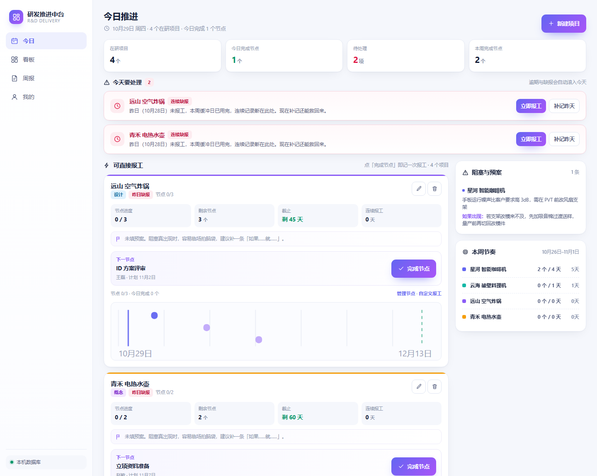
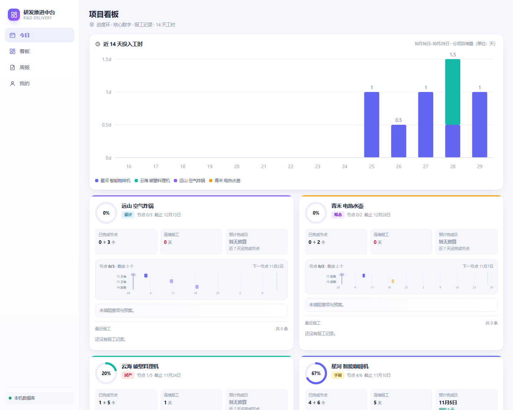
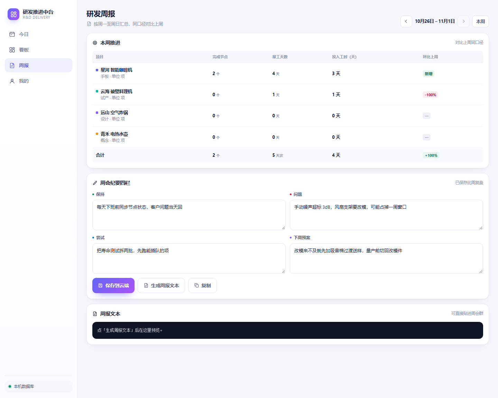
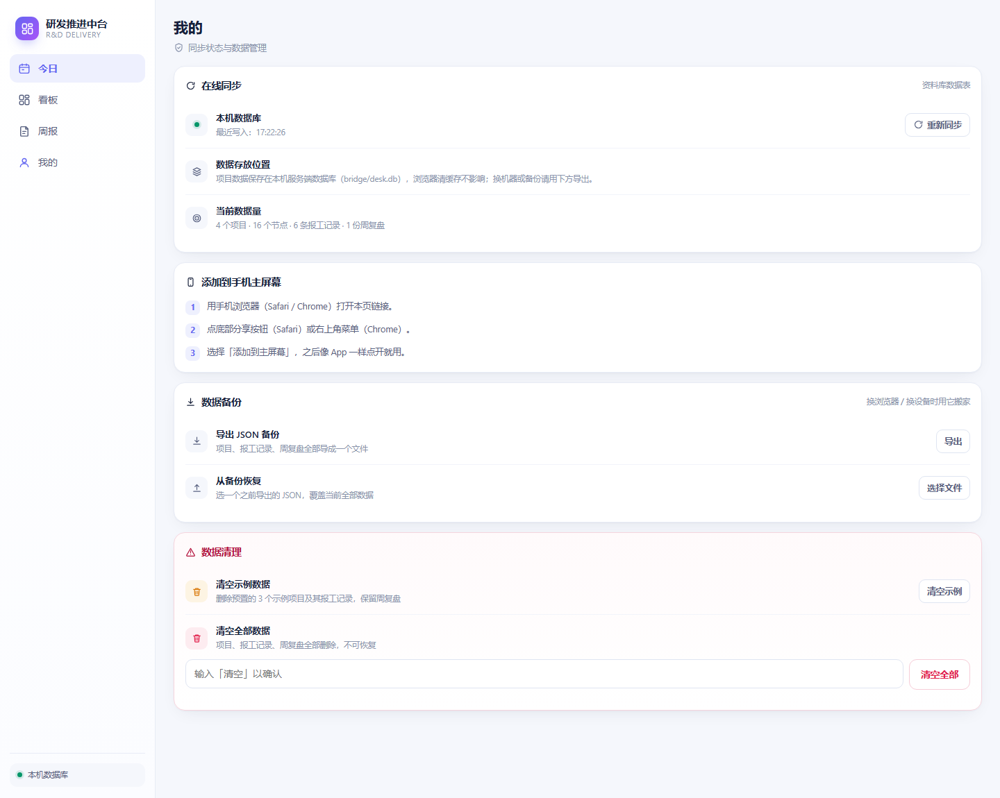

# 研发推进中台

一个**跑在自己电脑上**的项目推进看板：按「节点」管研发进度，不靠云端、不靠账号，
数据就一个 SQLite 文件，随时能拷走。

给硬件/家电类研发场景做的——项目不是"完成百分比"，而是拆成一串有日期的节点：
EV 手板、可靠性复测、3C 认证、试产、量产评审。看板回答三个问题：
**今天该动哪个节点、每个项目卡在哪、这周到底推进了多少。**



---

## 它解决什么问题

大多数项目管理系统是给"软件迭代"设计的：任务、看板、燃尽图。硬件研发不是这样：

- 一个节点卡住，后面全等它——供应商回样、模具、认证排期，全是几天到几周的硬等待；
- 进度不是"这周完成 30%"，而是"EV 手板过了没"；
- 真正要盯的是**日期**，不是工时。

所以这个工具的核心是**节点 + 计划完成日**，其他都从它推出来：
剩余节点、逾期、预计完成日（ETA）、甘特图、周报推进量。

另外两个硬约束来自实际使用环境：

1. **内网可跑**：不需要外网、不需要数据库服务、不需要登录。Python 标准库 + 一个 SQLite 文件。
2. **数据是自己的**：没有云端账号，没有同步协议。`bridge/desk.db` 拷走就是全部家当。

---

## 界面

四个视图，都是同一份数据的四种切法。

### 看板：项目全景 + 投入工时



每张卡是：完成率环、节点进度、剩余节点、连续报工天数、ETA、迷你甘特、最近报工。
上方堆叠柱状图是近 14 天每个项目投入了多少工时。

### 周报：本周推进 + 复盘



按项目统计完成节点、报工天数、投入工时、环比；下面四栏是周会纪要点（保持/问题/尝试/下周预案），
能一键生成可直接贴进群里的周报文本。

### 我的：备份与数据管理



导入导出 JSON、清空数据、看存储位置。

> 以上截图用的是仓库自带的演示数据（客户「星河/云海/远山/青禾」，人「张明/李静/王磊/赵敏」），
> 与实际项目无关。

---

## 快速开始

需要 Python 3.9+，无第三方依赖。

```bash
git clone <this-repo> rd-desk
cd rd-desk

# 1) 生成演示数据（日期按今天算，所以打开就像在用的系统）
python tools/make_demo_seed.py

# 2) 起服务
python local/server.py 8787
#    Windows 也可以双击 start-all.bat

# 3) 浏览器打开
#    http://127.0.0.1:8787/index.html
```

首次启动会自动用 `data/seed.demo.json` 建库灌数据。想换成自己的数据：
把真实种子放到 `data/seed.json`（格式见 [docs/数据模型.md](docs/数据模型.md)），删掉 `bridge/desk.db` 重启即可。

**不要双击 `local/index.html`**——`file://` 下页面拿不到 `/api`，会是空的。

---

## 架构

```
浏览器  local/index.html
          │  fetch /api
          ▼
    local/server.py          ← 标准库 http.server，静态 + JSON API
          │  sqlite3
          ▼
    bridge/desk.db           ← 唯一数据真身（一个文件）
          ▲
          │  只读镜像（可选）
        pmbot（飞书机器人，见 docs/pmbot-接入.md）
```

- **页面不是单机 HTML**：数据在服务端 SQLite，所以多开几个标签页看到的是同一份，
  改完 3 秒内其他页面自动刷新（靠 `/api/rev` 版本号轮询）。
- **记录整行存 JSON**：加字段不用改表结构；需要写 SQL 的地方用 `v_projects` / `v_nodes`
  等视图（见数据模型文档）。
- **前端零框架**：一段原生 JS，构建脚本把 6 个源文件拼成一个 HTML，没有 npm、没有打包器。

---

## 目录

```
local/            运行时代码：server.py（HTTP+API）、deskdb.py（存储）、index.html（构建产物）
src/              页面源码：build/ 下 8 个片段 + build.py 拼接
src/out/          构建中间产物（不入库）
data/             种子数据（seed.demo.json 演示用；seed.json 真实数据，不入库）
bridge/           运行时数据库（不入库）
docs/             文档：数据模型、部署运维、飞书接入、决策与踩坑记录
tools/            演示数据生成器
pmdesk.py         启停编排（center / bot / web 三个组件）
start-all.bat     一键启动（Windows）
stop-all.bat      一键停止（Windows）
```

---

## 页面怎么构建

源码是拆开的，改完要重新拼：

```bash
python src/build.py
#   local   -> local/index.html    主版本（走 /api）
#   legacy  -> local/legacy.html   纯 localStorage 版，应急/离线看板用
```

`local/index.html` 已随仓库提供，只是想跑起来不必构建。

---

## 可选：接飞书机器人

`pmbot` 是一个独立的飞书机器人项目（另一个仓库）。接上之后可以在飞书里问
"今天有什么要盯的""按工程师汇报所有项目"，答的是**这里**的实时数据。

接入方式是把本仓库的库只读镜像给 bot，**写操作全部禁用**——改数据只有中台一个入口。
代码见 `integrations/pmbot/`，说明见 [docs/pmbot-接入.md](docs/pmbot-接入.md)。

没装 pmbot 也能用，`pmdesk.py` 会自动跳过。

---

## 已知局限

这些是设计取舍，不是待修 bug，写在这里免得误用：

1. **单人单机**。服务只绑 `127.0.0.1`，没有登录体系。要给同事用需要改绑定并自己加鉴权。
2. **页面依赖服务**。服务不跑，页面是空的；离线能力只剩 `legacy.html`（自带数据快照，不落库）。
3. **节点没有业务主键**。节点靠"项目 + 节点名"识别，改名会被当成"删一条、加一条"。
4. **项目必须拆成节点才有意义**。只有一个节点的项目，进度条只有 0% 和 100% 两档，
   而且节点完成后项目看起来就"完成"了——这是节点驱动的固有代价。
5. **没有权限区分**。谁能打开页面谁就能改。
6. **无历史审计**。只保留最后一次写入时间，不记谁改了什么。

---

## 文档

| 文档 | 内容 |
|---|---|
| [docs/数据模型.md](docs/数据模型.md) | 表结构、字段含义、视图、种子格式 |
| [docs/部署与运维.md](docs/部署与运维.md) | 启动停止、备份恢复、端口、排错 |
| [docs/pmbot-接入.md](docs/pmbot-接入.md) | 飞书机器人怎么只读接入 |
| [docs/memory/00-索引.md](docs/memory/00-索引.md) | 决策记录与踩坑索引（为什么这么做） |

---

## 说明

仓库里的演示数据全部虚构；截图拍摄时用的就是这份演示数据，没有真实客户、项目或人名。
真实数据的种子文件（`data/seed.json`）和运行时数据库（`bridge/*.db`）都在 `.gitignore` 里，不会入库。
